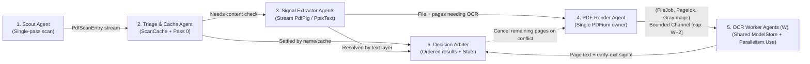

# Parallel-Agent Architecture Plan for `SchoolPdfSorter`

**Goal:** Speed up directory scanning, course-structure import, signal extraction, and scanned-PDF OCR using cooperating **in-process parallel agents** built around the **local AI models already in use (`NanoOCR`)**, while staying strictly inside the **exact same processing power ceiling** and **same disk/RAM footprint** on a student laptop, and **never weakening** the strict single-course-code decision rule in `AGENTS.md`.

---

## 1. Local AI Models Currently in Use (and What Stays Out of Scope)

An audit of `src/SchoolPdfSorter.Engine/SchoolPdfSorter.Engine.csproj` and `NanoOcr.dll` (`NanoOCR` `26.10.6797`) shows two distinct model stacks in the repository:

1. **Active Production Local AI Stack — `NanoOCR` (pure-C# Indra OCR, embedded in `NanoOcr.dll`, `44,679,680` bytes):**
   - Runs via NanoOCR's own zero-ORT ONNX interpreter (`NanoOcr.Onnx.InferenceSession`), SIMD GEMM/Conv kernels (`NanoOcr.Core.Gemm`), OpenCV ports, `SkiaSharp`, and `PDFium`.
   - **Models actively used under current options** (`ClassifyPages = false`, `Math = false`, `Mode = ConvertMode.Auto`):
     - `NanoOcr.Models.det.onnx` (`389,948` B) — line detection
     - `NanoOcr.Models.orient.onnx` (`371,414` B) — page orientation
     - `NanoOcr.Models.rec.onnx` (`4,977,797` B) — CTC line text recognition
     - `NanoOcr.Models.script.onnx` (`191,005` B) & `NanoOcr.Models.rec_cjk.onnx` (`9,255,441` B) — script check / CJK fallback
     - `NanoOcr.Models.order.onnx` (`2,973,138` B) — reading order & layout heads
   - **Models embedded in `NanoOcr.dll` but kept unloaded** (do not enable; saves RAM):
     - `pagetype.onnx` (`6,096,152` B) and math suite (`mathcls.onnx`, `math_enc.onnx`, `math_dec_init.onnx`, `math_dec_step.onnx`, `~19.9 MB` combined).
2. **Dormant Reference Stack (`Embedder.cs`, `ImagePrep.cs`, `Planner.cs`, `probe/models/`):**
   - EmbeddingGemma 2 (`model_q4.onnx` + `vision_encoder_q4.onnx` + `tokenizer.json`, `~315 MB` total for q4) is explicitly excluded via `<Compile Remove="..." />` in `SchoolPdfSorter.Engine.csproj` and omitted from the single-file publish (`latest.json` v1.1.5 is `117,060,910` bytes / `~111.6 MiB`).
   - **Scope constraint:** Re-enabling EmbeddingGemma 2 or adding ONNX Runtime / any new NuGet packages would break the footprint constraint (`~111.6 MiB` exe and student-laptop RAM) and violate `AGENTS.md`. All parallel agents in this plan operate strictly over **NanoOCR + PdfPig + PptxText**.

---

## 2. Why Current Runs Are Slower Than Necessary (Verified Bottlenecks)

Reading `ChatSession.cs`, `PdfScanner.cs`, `PdfServices.cs`, `CourseStructureDocument.cs`, and `Sorter.cs` reveals seven concrete bottlenecks:

| ID | Location | Current Behavior | Impact on Speed / Footprint |
| --- | --- | --- | --- |
| **B1** | `ChatSession.RunFlowAsync` + `PdfScanner.Scan` | Walks the source tree **3–4 separate times** (`files` scan, `WarnAboutLegacyPowerPoints` for `.ppt`, `ReportScanNotes` for `.doc/.docx/...`, plus `AutoFillCoursesAsync`) and allocates `new FileInfo` sequentially per matched file. | Multiplies disk metadata I/O on large student `Downloads` trees. |
| **B2** | `PdfServices.cs` (`PdfText.Extract`) | Calls `PdfDocument.Open(File.ReadAllBytes(path))` across up to 4 threads concurrently, even though only pages `1..5` (`PdfText.MaxPages`) are inspected. | Massive transient Large Object Heap (LOH) spikes (e.g., 4 × 30 MB PDFs = `120+ MB` transient RAM) and GC pauses. |
| **B3** | `Sorter.Run` (Pass 0.5 -> Pass 1) | Uses `Parallel.For` (`1..4` threads) for all `Signals.ExtractSafe` calls and **blocks on a global barrier** before Pass 1 starts. | One large/corrupt PDF stalls OCR from starting on hundreds of already-extracted files. |
| **B4** | `Sorter.Run` (Pass 1 OCR loop) | Completely sequential `for (int i = 0; i < total; i++)` calling `ocr.Predict(file.Path, maxPages: scanPages)` one file and one page at a time, with `Threads = Environment.ProcessorCount` inside each page. | NanoOCR's own benchmarks show 4 threads on 1 page gives only `~2×` speedup (`214-230 ms` at 1T vs `106-128 ms` at 4T on a 1700×2200 page) due to per-operator sync, sequential `Pdfium.Lock`, and narrow recognizer batches. On 8–16 logical core student laptops, cores sit under-utilized or thrash barriers. |
| **B5** | `CourseStructureDocument.ReadText` + `Sorter.Run` | Step 2 constructs `new NanoOCR(...)`, OCRs up to 40 pages **sequentially**, and **disposes** it; Step 4 constructs **another** `new NanoOCR(...)` from scratch (and again on repeat runs). | Pays `OcrInitSeconds` (protobuf parse, `FoldConstants`, `Fuse`) repeatedly and leaves Step 2 single-file OCR slow. |
| **B6** | `Sorter.Decide` (`ConvertMode.Auto`) | `Sorter` runs `PdfPig` first; when `NeedsOcr` triggers (0 codes, or mixed text+blank-page PQ), it invokes `ocr.Predict(file.Path)` across **all** `scanPages` (`1..5`) in `ConvertMode.Auto`, re-checking/running `det`+`order` even on pages `PdfPig` already extracted cleanly. | Redundant PDFium check-renders and layout inference on already-readable pages. |
| **B7** | `NanoOcr.Pdf.Pdfium.Lock` | PDFium is process-global non-thread-safe; naive multi-threaded `ocr.Predict(path)` workers serialize against each other on `Pdfium.Lock`. | Blocks CPU inference workers behind PDF open/render calls. |

---

## 3. Target Architecture: Cooperating In-Process Specialist Agents

### Why In-Process Agents (Not Multi-Process, Not Extra Models)
Spawning $W$ worker processes would multiply the `.NET` runtime, native DLLs, and `~44 MB` embedded model weights by $W\times$, blowing past a student laptop's RAM. Instead, `NanoOcr.Models.ModelStore` and `NanoOcr.Pipeline.NanoOcrEngine` explicitly document that parsed/fused model sessions are **immutable once loaded and thread-safe across concurrent `Process` / `Run` calls**, while `NanoOcr.Core.Parallelism.Use(int threads)` uses an `AsyncLocal` scope to pin kernel thread count per concurrent worker.

That lets us run **6 cooperating specialist agents inside one process**, sharing **1 model store in RAM**, linked by **strictly bounded `System.Threading.Channels` queues**:

### Role of Each Agent

1. **Shared Model Host (`OcrModelHost`, internal singleton/session-scoped):**
   - Lazily constructs one `NanoOcrEngine` / `ModelStore` (with `ClassifyPages = false`, `Math = false`, `KeepImages = false`, `Fusion = true`) on first need and shares it across **both** `CourseStructureDocument` (Step 2) and `Sorter` (Step 4, including subsequent runs in the same app session).
   - **Footprint impact:** Eliminates duplicate `NanoOCR` initialization (`OcrInitSeconds` paid at most once per app session) with **1×** static model weights in RAM regardless of worker count `W`.
2. **Scout Agent (`ScannerAgent`):**
   - Replaces the 3–4 separate `Directory.EnumerateFiles` passes in `ChatSession` + `PdfScanner` with a single `FileSystemEnumerable<T>` pass that classifies target files (`.pdf`, `.pptx`, `.ppsx`, `.pptm`), legacy `.ppt` files, unsupported extension hits (`.doc`, `.docx`, etc.), `~$` lock files, and sorted folders in one walk, retrieving length/timestamps directly from the Win32 `WIN32_FIND_DATA` entry without extra `new FileInfo(...)` stat syscalls.
   - Emits target `PdfScanEntry` items immediately instead of waiting for all notes to finish.
3. **Triage & Cache Agent (`TriageAgent`):**
   - Applies `ScanCache.Unchanged` and Pass 0 (`Signals.Light`, `IsTimetable`, `IsMultiCourse`, filename/folder `CourseCodes.Find`, `StopOnUnlistedCode`) per file.
   - Settled files go straight to the `DecisionArbiter` without touching file bytes or channels.
4. **Signal Extractor Agents (`SignalAgent` pool):**
   - Reads `.pptx`/`.ppsx`/`.pptm` via `PptxText.Extract` and `.pdf` via **stream-based** `PdfDocument.Open(File.OpenRead(path))` (never `File.ReadAllBytes`!).
   - Streams each `FileSignals` immediately downstream (no global Pass 0.5 barrier!).
   - Runs `Sorter` Pass 1 cheap-text evaluation (`MetadataTitle`, `BiggestLine`, `FirstPages`) immediately on extraction:
     - If settled (`Conflict`, `HasTimetable`, or `Listed.Count == 1 && !mustCheckScans`, or presentation), emits final `SorterFileResult` immediately.
     - Otherwise tags **which exact page indices** `[0..scanPages-1]` lack clean verified text (see Section 5 for broken-CMap / embedded-image safeguards) and forwards a `FileOcrJob` to `PdfRenderAgent`.
5. **PDF Render Agent (`PdfRenderAgent` — sole PDFium owner):**
   - Runs on **1 dedicated worker** so PDFium calls never contend on `NanoOcr.Pdf.Pdfium.Lock` and OCR inference workers never block waiting for PDFium.
   - Opens each `FileOcrJob` once via `NanoOcr.Pdf.PdfDocument.Open(path)`, renders only the flagged pages (at `_opt.Dpi`, capped identically to `DocumentConverter.PageScale`) into pooled `GrayImage` buffers, and writes `(FileOcrJob, PageIndex, GrayImage)` into a **strictly bounded channel** (`BoundedChannelOptions(W + 2)`).
   - **Zero wasted speculative rendering during steady state:** While `activeOcrFiles >= W`, renders at most 1 page ahead per active file (page `p+1` requested after page `p` finishes without conflict). Only in the **tail phase** (`activeOcrFiles < W`, or `CourseStructureDocument` where all up to 40 pages must be read) does it fan out pages `0..scanPages-1` across idle OCR workers.
   - Checks `fileJob.CancellationToken` before every page render; on conflict, skips all remaining pages immediately.
6. **OCR Inference Agents (`OcrWorkerAgent` pool, `W` workers) + Per-File `DecisionArbiter`:**
   - Each of the `W` workers pulls one `(FileOcrJob, PageIndex, GrayImage)` item, scopes `using (NanoOcr.Core.Parallelism.Use(workerThreads))`, runs `OcrModelHost.Engine.Process(gray, turn: true)` (or `TextLayer` check when needed), **immediately calls `gray.Return()` in `finally`**, and submits `(PageIndex, pageText)` to `FileOcrJob.Arbiter`.
   - **`DecisionArbiter` guarantees deterministic sequential semantics:** Stores page text into a fixed `string?[scanPages]` array under a per-file lock and advances a `nextPageToCommit` cursor (`0, 1, 2...`) in strict ascending page order, running `AddEvidence` + `Conflict`. The instant any committed page triggers `HasTimetable` or `Conflict(...)`, `FileOcrJob.Cancel()` fires and any unstarted/buffered `GrayImage` for that file is returned to `ArrayPool` untouched.

---

## 4. Resource Governor: Exact Same Processing Power & Footprint on a Student Laptop

A naive `Parallel.ForEach` over OCR models would spawn `N` multi-threaded sessions, oversubscribe cores, thermally throttle a thin laptop, and blow up RAM with buffered page images and LOH allocations. The following hard resource budgets prevent both:

### 4.1 Processing Power Budget (Zero Oversubscription & Thermal Safety)

Currently, `Sorter.cs` sets `NanoOcrOptions.Threads = Environment.ProcessorCount`, claiming up to `C = Environment.ProcessorCount` logical threads during OCR and `Math.Clamp(C / 2, 1, 4)` during signal extraction.

We enforce a **single global concurrency budget `B`** shared across **all** agents:

- **Hard CPU ceiling:**
  $$B = \text{opt.Threads} > 0 \ ? \ \min(\text{opt.Threads}, C) \ : \ \text{DefaultLaptopBudget}(C)$$
  Never exceeds `Environment.ProcessorCount` (exact same upper bound as today).
- **Physical-Core Awareness for Student Laptops:**
  - On typical 4C/8T, 6C/12T, or hybrid P+E-core student laptops, running `C` heavy AVX2 GEMM workers simultaneously causes Hyper-Thread ALU contention, L2/L3 cache thrashing, and higher heat/wattage than `P` physical-core workers.
  - Query Windows physical core count via `GetLogicalProcessorInformationEx` (safe fallback: `Math.Max(1, C / 2)` when `C >= 8`, or `C` on 4-thread CPUs) and set steady-state OCR worker count:
    $$W_{\text{cpu}} = \text{Clamp}(\text{PhysicalCores}, 1, B)$$
  - **Steady state (`queuedPages >= W`):** Run `W` OCR agents × `Parallelism.Use(1)` = `W` active compute threads ($\le B$), leaving SMT/UI headroom so the student's WPF window, mouse, `/cancel`, and background browser stay fluid, at **lower or equal peak CPU wattage**.
  - **Elastic Tail Donation (`inFlightFiles < W`):** When only `k < W` files (or Step 2's single 40-page course structure) remain, split all `B` threads across the `k` active page jobs via `Parallelism.Use(Math.Max(1, B / activePageWorkers))`, matching current full-core speed on single-page inputs.
  - **Thread-Budget Coupling Across Stages:** `SignalAgent` + `PdfRenderAgent` + `OcrWorkerAgent` acquire permits from one shared lightweight concurrency gate capped at `B`, ensuring overlapping signal extraction and OCR never exceed `B` active compute threads.
  - **Worker Thread Priority:** Run OCR workers at `ThreadPriority.BelowNormal` so Windows scheduler always prioritizes the WPF UI dispatcher and user input.

### 4.2 Disk & Memory Footprint Budget (Exact Same or Lower Peak Working Set)

| Component | Current v1.1.5 Footprint | Planned Parallel-Agent Footprint | How Footprint Is Held Constant / Lowered |
| --- | --- | --- | --- |
| **Single-file `.exe` size** | `117,060,910` B (`~111.6 MiB`) | `~111.6 MiB` (`+<50 KB` C#) | **Zero** new NuGet packages, **zero** new models; `Embedder.cs`/`ImagePrep.cs`/`Planner.cs` remain excluded. |
| **Loaded ONNX models** | `1×` in Step 2 (disposed) + `1×` in Step 4 (`~18–27 MB` weights + fused graphs) | `1×` shared across Step 2 & Step 4 | `ModelStore` / `InferenceSession` parsed once; `ClassifyPages` & `Math` stay `false`. |
| **`PdfPig` file buffers** | `File.ReadAllBytes` × up to 4 threads (`50–200+ MB` LOH spikes on large PDFs) | **`~0 MB` LOH** (streamed `File.OpenRead`) | `PdfDocument.Open(FileStream)` reads only cross-ref + pages `1..5`. |
| **Rendered `GrayImage` pages** | `1` page (`~4 MB` @ 200 DPI A4) | Bounded to `W + 2` pages (`~24 MB` max for `W=4`) | `BoundedChannel` capacity `W + 2` + mandatory `GrayImage.Return()` in `finally`. |
| **Per-worker ONNX tensor arena** | `1 ×` pooled activations (`~8 MiB`/warm page + peak intermediates) | `W ×` pooled activations, **RAM-capped** | `W = min(W_cpu, W_ram)` where `W_ram` uses `GC.GetGCMemoryInfo().TotalAvailableMemoryBytes` (e.g., `<= 4` workers on `<= 8 GB` student laptops, `<= 6–8` on `16+ GB` laptops). |

**Net effect on an 8 GB student laptop:** Eliminating `File.ReadAllBytes` LOH spikes frees `50–150+ MB` of transient RAM, offsetting the bounded `(W + 2)` page bitmaps and `W <= 4` pooled ONNX tensor arenas so `PeakWorkingSet64` stays **at or below** the current v1.1.5 baseline.

---

## 5. Correctness, Determinism & Edge-Case Invariants

1. **Strict Single-Code Rule & Exact Reasons (`AGENTS.md` + `SorterTests.cs`):**
   - `DecisionArbiter` commits page evidence strictly in page index order `0 -> scanPages - 1`. Therefore, `ListedWhere`, `TimetableWhere`, `Foreign` insertion order, `Tier`, `OcrPages`, `Reason`, `CourseSuggester` hints, and `ScanCache` payloads are **deterministic and identical** to sequential execution.
   - `SorterRunResult.Items` is populated into a preallocated `SorterFileResult[paths.Count]` array by original index so output order never drifts.
2. **Safe Per-Page OCR Skip (Addressing B6 Without Missing Hidden Text):**
   - Only skip rendering/OCR for a page index `p` when `PdfPig` extracted `>= 20` non-whitespace characters **and**:
     - The text contains no replacement/control/broken-CMap characters (`\uFFFD`, private-use surrogates, high non-printable ratio), **and**
     - If `Listed.Count == 0` after all cheap passes, any page that contains embedded raster images (where a scanned/image header might hold the course code) still goes through `PdfRenderAgent` + `NanoOCR` (`TextLayer.Read` / `ImageOcr` parity).
   - Otherwise (`< 20` chars, broken CMap, or image-only page), `PdfRenderAgent` renders page `p` directly for `OcrWorkerAgent`, skipping `det`/`order` wasted on cleanly extracted born-digital pages.
3. **PowerPoint Policy Preserved:**
   - `.pptx`, `.ppsx`, `.pptm` stay strictly in `SignalAgent` (`PptxText.Extract`); picture-only decks never enter `PdfRenderAgent` or `OcrWorkerAgent`. Legacy `.ppt` files are surfaced by `ScoutAgent` in one pass with the exact same user warning.
4. **Course-Structure Import (`CourseStructureDocument.ReadText`) Parity:**
   - Reuses the shared `OcrModelHost` and runs up to `MaxPages = 40` pages concurrently across `W` `OcrWorkerAgent`s (either via `PdfRenderAgent` + `OcrWorkerAgent` or `NanoOCR.PredictMany` with `cores: W`), then joins `page.Markdown` / `page.RecTexts` strictly in index order `0..N-1` so `CourseStructure.ParseDetailed` sees identical table rows.
5. **Cancellation & Progress Monotonicity (`ChatSession.cs`):**
   - Replacing the 2-phase jump (`signals` 0–25% vs `ocr` 25–100%) with an atomic progress aggregator (`Interlocked` counts for triaged, signal-extracted, OCR-pages-done, and finalized files) throttled to ~10 Hz ensures the WPF progress bar moves monotonically and never floods `Dispatcher`.
   - `/cancel` or **Cancel run** cancels the linked `CancellationTokenSource`, drains all channel consumers, returns all rented `GrayImage` buffers, and awaits worker completion before resetting `_busy` or touching `ScanCache`.

---

## 6. Phased Implementation Plan

### Phase 0 — Measurement & Baseline Gate (`tools/SchoolPdfSorter.Bench`)
- Extend `tools/SchoolPdfSorter.Bench/Program.cs` to record:
  - Wall time (`TotalSeconds`, `SignalSeconds`, `ScanSeconds`, `OcrSeconds`, `OcrInitSeconds`),
  - `Process.GetCurrentProcess().PeakWorkingSet64` and `GC.GetTotalAllocatedBytes(precise: false)`,
  - Optional `--threads`, `--workers`, and `--corpus` stress mode (mixed born-digital large PDFs + multi-page scanned PDFs).
- Capture baseline numbers on `probe/testcorpus` (`38` files) and a multi-page/large-PDF local benchmark set before modifying engine code.

### Phase 1 — Zero-Risk Footprint & I/O Wins
1. **`PdfServices.cs` (`PdfText.Extract`):** Switch from `File.ReadAllBytes(path)` to streaming `File.OpenRead(path)` + `PdfDocument.Open(stream)` so pages `1..5` never allocate whole-file `byte[]` on the LOH.
2. **`PdfScanner.cs` + `ChatSession.cs`:** Add a unified single-pass `PdfScanner.ScanWorkspace(...)` returning target files, legacy `.ppt` course-named hits, unsupported course-named hits, `~$` temporary count, and sorted folders from **one** directory walk (keeping `PdfScanner.Scan` intact for existing tests/callers).
3. **`OcrModelHost.cs` (new internal helper in `SchoolPdfSorter.Engine`):** Thread-safe lazy holder for shared `NanoOcrEngine` / `NanoOCR` options (`ClassifyPages = false`, `Math = false`, `KeepImages = false`) shared by `CourseStructureDocument` and `Sorter`.

### Phase 2 — Pipelined Multi-Agent Execution (`Sorter.cs` & `CourseStructureDocument.cs`)
1. **`ResourceBudget.cs`:** Compute `B` (total thread ceiling $\le \text{ProcessorCount}$), `W` (physical-core + `GC.GetGCMemoryInfo().TotalAvailableMemoryBytes`-guarded OCR workers), and shared concurrency semaphore.
2. **Channel Pipeline in `Sorter.Run`:**
   - Wire `Triage -> SignalAgent pool -> PdfRenderAgent -> BoundedChannel(W + 2) -> OcrWorkerAgent pool -> DecisionArbiter`.
   - Use `NanoOcr.Core.Parallelism.Use(workerThreads)` inside each `OcrWorkerAgent` and `GrayImage.Return()` in `finally`.
   - Enforce per-file `DecisionArbiter` ascending-page commit and immediate `CancellationTokenSource.Cancel()` on early conflict/timetable.
3. **Parallelize `CourseStructureDocument.ReadText`:** Route scanned multi-page course structures through `OcrModelHost` across `W` parallel page workers, assembling page markdown in ascending `PageIndex` order and reporting per-page progress.

### Phase 3 — Per-Page OCR Skip & Elastic Tail Donation
1. **Per-page skip logic:** Skip rendering pages `p` where `PdfPig` extracted clean non-corrupt text (`>= 20` chars, no broken CMap, and no unverified image-only trap when `Listed.Count == 0`).
2. **Elastic tail donation:** When active OCR jobs fall below `W`, allow `PdfRenderAgent` to queue remaining pages of active files ahead (up to channel bound) and compute `workerThreads = Math.Max(1, B / activePageWorkers)` via `Parallelism.Use(workerThreads)` so the tail finishes at full core speed without exceeding `B`.

### Phase 4 — UI Progress & Hardening (`ChatSession.cs` & Tests)
1. **Monotonic Throttled Progress in `ChatSession.cs`:** Update `SorterProgress` handling so pipelined `signals`, `render`, and `ocr` counters advance the progress bar smoothly without stepping backward, and keep existing plain-English student status wording.
2. **Automated Parity & Concurrency Tests (`tests/SchoolPdfSorter.Tests`):**
   - `ParallelSorterTests`: Verify bit-for-bit identical `Action`, `Course`, `Code`, `Tier`, `Reason`, `OcrPages`, and `ScanCache` outputs between `W = 1` (sequential reference) and `W > 1` (parallel agents) across single-page, multi-page, early-conflict, broken-text-layer, mixed text+scan, and PPTX inputs.
   - Stress-test rapid `/cancel` mid-OCR to verify clean worker teardown, zero leaked handles, and zero `ArrayPool` / `GrayImage` corruption.

---

## 7. Verification & Acceptance Criteria

All changes must pass before release (`publish.cmd` / `release.ps1`):

1. **Unit & Parity Tests:**
   `"%USERPROFILE%\.dotnet10\dotnet.exe" test tests\SchoolPdfSorter.Tests` passes 100% (existing `SorterTests`, `IncrementalTests`, `PptxTests`, `PdfServicesTests`, `CourseStructureTests` + new `ParallelSorterTests`) with zero relaxed assertions.
2. **Benchmark Parity & Speedup Gate (`tools\SchoolPdfSorter.Bench`):**
   - **Accuracy:** `0` wrong moves, `0` ambiguous moves, exact match with baseline `moves` and `dumps` on `probe/testcorpus`.
   - **Speedup:** Measurable wall-time reduction on multi-file scanned PDFs and scanned 8–40 page course structures (target `>= 2×` on 4C/8T and `>= 3×` on 6C–8C student laptops when OCR-bound).
   - **Power & Thread Ceiling:** Active compute threads never exceed `B` (`<= Environment.ProcessorCount`, default physical-core capped during steady state) and workers run at `ThreadPriority.BelowNormal` so the WPF UI stays responsive.
   - **Footprint Ceiling:** Published `publish\SchoolPdfSorterApp.exe` remains `~111.6 MiB` (no added packages/models); `PeakWorkingSet64` on mixed/large-PDF runs stays `<=` current v1.1.5 baseline (with lower LOH allocations from streamed `PdfPig`).
